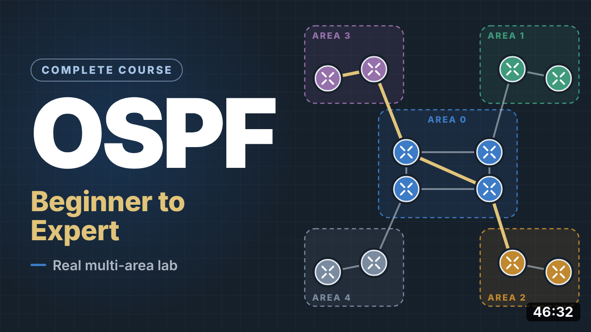
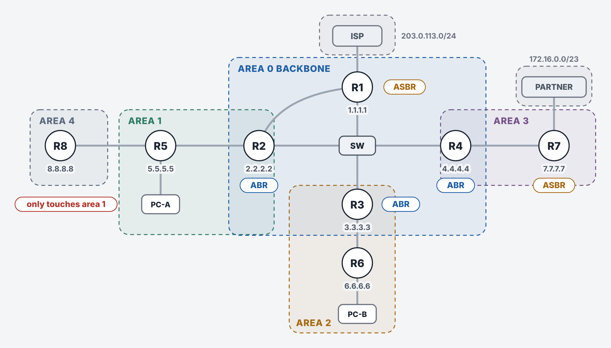
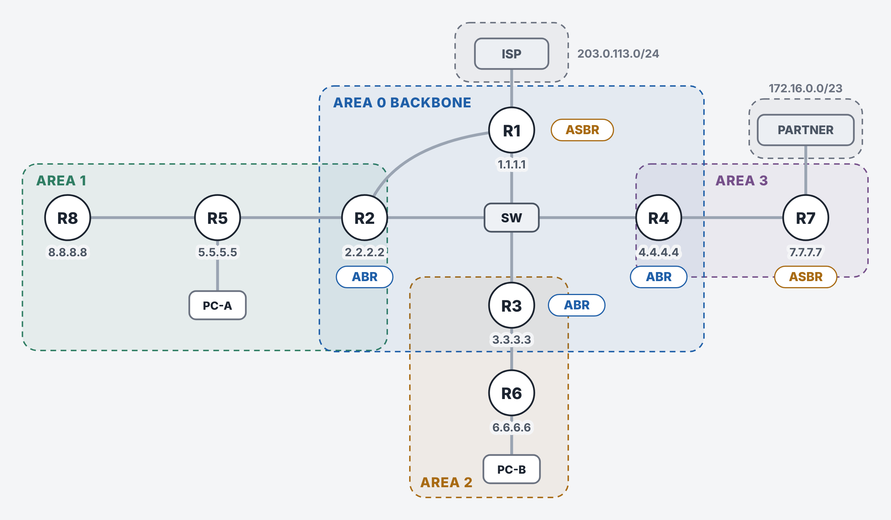

<p align="center">
  
</p>

<p align="center">
  <b>A complete OSPF course, from the first Hello to multi-area design and troubleshooting, built on one real Cisco Packet Tracer lab.</b>
</p>

<p align="center">
  
  
  
  
  <a href="https://youtu.be/Hul1ntaAMCo"></a>
</p>

<p align="center">
  <a href="#watch-the-course">Video</a> ·
  <a href="#the-lab">The lab</a> ·
  <a href="#what-the-lab-proves">What it proves</a> ·
  <a href="#try-it-yourself">Try it</a> ·
  <a href="#packet-tracer-limits">Limits</a> ·
  <a href="#repository-map">Files</a>
</p>

---

## Watch the course

<p align="center">
  <a href="https://youtu.be/Hul1ntaAMCo">
    
  </a>
</p>

A 46-minute narrated course that starts with IP addresses and routing tables and ends with configuration and troubleshooting. Every command output on screen comes from this lab. When Packet Tracer can't do something, the video says so and shows real Cisco IOS syntax instead.

**▶ [Watch on YouTube](https://youtu.be/Hul1ntaAMCo)**. The video has English captions.

<details>
<summary><b>Chapters</b></summary>

| Time | Chapter |
| --- | --- |
| [0:00](https://youtu.be/Hul1ntaAMCo?t=0) | Introduction |
| [1:01](https://youtu.be/Hul1ntaAMCo?t=61) | Networking basics |
| [2:59](https://youtu.be/Hul1ntaAMCo?t=179) | Dynamic routing and where OSPF fits |
| [5:58](https://youtu.be/Hul1ntaAMCo?t=358) | OSPF in three steps |
| [7:49](https://youtu.be/Hul1ntaAMCo?t=469) | The router ID |
| [9:02](https://youtu.be/Hul1ntaAMCo?t=542) | OSPF packets |
| [10:14](https://youtu.be/Hul1ntaAMCo?t=614) | Hellos and neighbor rules |
| [11:47](https://youtu.be/Hul1ntaAMCo?t=707) | Neighbor states |
| [12:47](https://youtu.be/Hul1ntaAMCo?t=767) | Network types and the DR |
| [17:07](https://youtu.be/Hul1ntaAMCo?t=1027) | The link state database |
| [19:10](https://youtu.be/Hul1ntaAMCo?t=1150) | Cost and best paths |
| [22:06](https://youtu.be/Hul1ntaAMCo?t=1326) | Areas |
| [23:40](https://youtu.be/Hul1ntaAMCo?t=1420) | Routes between areas |
| [24:50](https://youtu.be/Hul1ntaAMCo?t=1490) | External routes |
| [27:34](https://youtu.be/Hul1ntaAMCo?t=1654) | Two details: loopbacks and passive interfaces |
| [28:32](https://youtu.be/Hul1ntaAMCo?t=1712) | Stub areas |
| [29:55](https://youtu.be/Hul1ntaAMCo?t=1795) | Totally stubby areas |
| [30:39](https://youtu.be/Hul1ntaAMCo?t=1839) | NSSA |
| [32:15](https://youtu.be/Hul1ntaAMCo?t=1935) | Summarization |
| [33:36](https://youtu.be/Hul1ntaAMCo?t=2016) | Virtual links |
| [35:14](https://youtu.be/Hul1ntaAMCo?t=2114) | Authentication |
| [36:33](https://youtu.be/Hul1ntaAMCo?t=2193) | Filtering and fast convergence |
| [37:47](https://youtu.be/Hul1ntaAMCo?t=2267) | OSPF version 3 for IPv6 |
| [39:18](https://youtu.be/Hul1ntaAMCo?t=2358) | Configuring OSPF step by step |
| [41:31](https://youtu.be/Hul1ntaAMCo?t=2491) | Troubleshooting |
| [45:08](https://youtu.be/Hul1ntaAMCo?t=2708) | Recap and best practices |

</details>

---

## The lab



Eight OSPF routers in five areas, plus an internet provider and a partner network that sit outside OSPF.

| Router | Role |
| --- | --- |
| R1 | Backbone router and ASBR: originates the default route and redistributes the provider network 203.0.113.0/24 |
| R2, R3, R4 | ABRs between area 0 and areas 1, 2 and 3 |
| R5 | Area 1 router with the PC-A LAN and three loopback networks; also connects area 4 |
| R6 | Area 2 router with the PC-B LAN |
| R7 | Area 3 router and ASBR: redistributes the partner networks 172.16.0.0/24 and 172.16.1.0/24 |
| R8 | Area 4, the area that does not touch area 0 (the virtual link chapter) |

The four backbone routers share one switch, so they elect a DR and BDR. R1 and R2 also have a direct gigabit cable, which creates the equal-cost paths used in the cost chapter. Router IDs are 1.1.1.1 to 8.8.8.8, set by hand.

Full device list, addressing and configuration stages: [`docs/LAB-DESIGN.md`](docs/LAB-DESIGN.md).

<details>
<summary><b>The final saved lab</b></summary>

<br>



`OSPF-Multi-Area-Lab.pkt` holds the end state of the course: R1 is DR and R2 is BDR, the reference bandwidth is 10000 on every router, area 1 is summarized as 10.1.0.0/16 with MD5 on R2-R5, and area 2 is totally stubby.
Area 4 is folded into area 1. In Packet Tracer, an active virtual link makes the ABRs originate bogus Type 4 LSAs and external routes loop, so the virtual link is shown in its own captures instead of in the saved file.

</details>

---

## What the lab proves

Each step was applied by script and its output saved in [`evidence/`](evidence/).

| Topic | Result in the lab | Evidence |
| --- | --- | --- |
| DR/BDR election | R4 wins on router ID; R3 takes over when R4 fails; R4 returns as a DROTHER (non-preemptive) | `01_base` to `05b_prio_zero` |
| Cost and ECMP | 100 Mbps and 1 Gbps paths tie at cost 1 by default; `auto-cost reference-bandwidth 10000` separates them | `06_cost_default`, `07_cost_refbw` |
| LSA types | Type 1 and 2 inside area 0, Type 3 from each ABR, Type 4 for the ASBR, Type 5 externals | `01_base` |
| External routes | E1 cost grows with distance (R5 sees 40, R7 sees 130); E2 stays at 20 everywhere | `21_stage2_fresh` |
| Stub areas | Area 2 database drops from 23 LSAs (normal) to 18 (stub) to 3 (totally stubby) | `11b`, `12` |
| Summarization | One 10.1.0.0/16 route instead of five, with a Null0 discard route on the ABR | `15_summary_r2`, `17_summary_both` |
| Virtual link | Area 4 reaches the backbone through area 1; R8 learns the inter-area routes | `16_virtual_link` |
| Authentication | MD5 on one side drops the neighbor; on both sides it returns to FULL | `18`, `19` |
| OSPFv3 | Router ID still 32 bits, link-local next hops, Link (Type 8) and Intra-Area-Prefix (Type 9) LSAs | `20_ospfv3` |
| Troubleshooting | Seven injected faults: hello timers, area ID, subnet mask, MTU, passive interface, duplicate router ID, network type | `30` to `33` |

The full index of all 36 captures is in [`evidence/README.md`](evidence/README.md).

---

## Try it yourself

1. Install [Cisco Packet Tracer](https://www.netacad.com/cisco-packet-tracer) 9.0 or later.
2. Open `OSPF-Multi-Area-Lab.pkt`.
3. Open any router's CLI and start with:

   ```text
   show ip ospf neighbor
   show ip ospf interface brief
   show ip route ospf
   show ip ospf database
   show ip protocols
   ```

4. Break something on purpose, for example `ip ospf hello-interval 5` on one end of a link, and watch the neighbor drop after the dead timer. The faults used in the video are listed in [`evidence/README.md`](evidence/README.md).

The full configuration of every device is in [`configs/final/`](configs/final/).

---

## Packet Tracer limits

Packet Tracer runs IOS 15.1(4)M4 and models a subset of OSPF. In this lab:

- NSSA is accepted, but no Type 7 LSAs are generated.
- An active virtual link causes bogus Type 4 LSAs and an external routing loop.
- MTU mismatches are not enforced, and `ip ospf hello-interval` does not change the dead interval.
- NBMA and point-to-multipoint network types, key-chain (HMAC-SHA) authentication, BFD and route filtering are not supported. The video teaches them from Cisco documentation and labels them on screen.

Every quirk, with the capture that shows it: [`docs/PACKET-TRACER-NOTES.md`](docs/PACKET-TRACER-NOTES.md).

---

## Repository map

| Path | What's inside |
| --- | --- |
| `OSPF-Multi-Area-Lab.pkt` | The finished lab |
| [`configs/`](configs/) | Device configurations for each stage: `base`, `stage2` and `final` |
| [`evidence/`](evidence/) | Raw `show` output for every step, with the exact commands applied |
| [`docs/LAB-DESIGN.md`](docs/LAB-DESIGN.md) | Devices, addressing, areas and configuration stages |
| [`docs/PACKET-TRACER-NOTES.md`](docs/PACKET-TRACER-NOTES.md) | Where Packet Tracer differs from real IOS |
| [`automation/`](automation/) | Packet Tracer JavaScript used to build, configure and capture the lab |
| `docs/brand/`, `docs/images/` | Logo, banner, topology diagrams and the video preview |

---

<sub>Built in Cisco Packet Tracer 9.0. All credentials and keys are disposable lab values. Packet Tracer models a subset of real IOS behavior.</sub>
